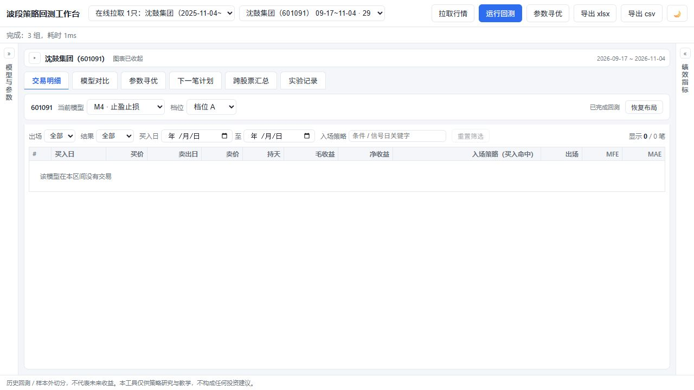

# 波段策略回测工作台 · Strategy Workbench


> 本地优先的 A 股日线策略研究工具：回测、参数稳健性诊断、跨股票比较与下一笔计划跟踪。



**快速导航：** [快速开始](#2-快速开始启动与浏览) · [功能清单](#3-已实现功能交付清单) · [帮助手册](帮助手册.md) · [参与贡献](CONTRIBUTING.md) · [安全政策](SECURITY.md)

**交流与反馈：** 讨论 QQ 群 `1131751562`。欢迎交流策略研究、使用经验、缺陷反馈与改进建议。

本地单机 Web 应用，用于**个股日线波段策略**的回测、K 线可视化、参数寻优、过拟合诊断、跨股票对照，以及面向「下一次操作」的参考计划。

> ⚠️ **免责声明**：历史回测与样本外切分**不代表未来收益**。本工具仅供策略研究与教学，**不构成任何投资建议**，亦非证券投资咨询。请勿据此直接交易。

---

## 0. 项目简介

- **定位**：把「全样本最优参数很美，但一上实盘就崩」这件事，用**诚实 / 乐观 / Oracle 三口径 + 红绿灯**讲清楚；并提供可对比的对照基线（买入持有、DP 事后最优上界）。
- **核心卖点**：参数寻优采用**留样检验**而非全样本最优，直接给出迁移损失与乐观偏差，专治过拟合幻觉。
- **数据**：内置「样例合集（7 只 · 300 日 · 前复权）」——莲花控股 600186、东方钽业 000962、中大力德 002896、中贝通信 603220、城地香江 603887、大元泵业 603757、特锐德 300001。
- **形态**：FastAPI 后端 + React/TS 前端，SQLite 持久化，前端 `dist` 由后端静态托管。

---

## 1. 技术栈与架构

- **后端**：Python 3.11+（开发环境 3.13）、FastAPI、SQLite；`backend/engine/` 为**纯函数回测引擎**（不依赖 FastAPI/DB，可被 pytest 与 CLI 复用）。
- **前端**：React 18 + TypeScript + Vite + ECharts 5。
- **回测引擎关键点**：严格因果、无未来函数（见 §7 防未来函数）。

```
strategy-workbench/
  backend/
    engine/            # 纯函数引擎（可独立于 Web 运行与测试）
      types.py         # Bar / RunResult / Metrics 等数据类型
      data.py          # 指标: ma / donchian / bollinger / 复权 / 涨跌停判定
      cost.py          # 费用模型 + 滑点(slippage_pct)
      factors.py       # 量价因子库(15 因子 + Spearman IC)
      metrics.py       # 指标计算: 年化/回撤/夏普/Calmar/胜率/盈亏比…
      backtest.py      # run(): 撮合（T+1、high/low 触发、约束、滑点）
      audit.py         # 防未来函数审计（50 随机截断点）
      optimize.py      # 网格寻优 + 训练/测试留样反过拟合 + walk_forward
      models/ base.py builtin.py   # M1/M3/M4/M6/M9/M10 + dp_oracle
      signals.py       # 买入触发信号库（5 种入场，严格因果）
      rules.py         # 自定义规则 DSL（17 指标×6 比较符×4 时序算子，AND/OR 嵌套）
      plan.py          # next_plan(): 下一笔交易计划（BUY-01～10 结构化契约）
      plan_conditions.py # 计划侧条件树 + 下一根触发求解（解析阈值/区间/数值扫描）
      trading_calendar.py # 交易日历（数据集真实交易日 > 休市安排 > 工作日估算，未知不冒充确认）
      version.py       # 引擎口径版本（进实验/参数指纹）
    application/ run_service.py optimize_service.py plan_service.py plan_review.py summary_service.py
    db/ schema.sql repository.py experiments.py plans.py importer.py  # 数据集 / 回测 / 实验 / 计划跟踪持久化
    api/ models.py datasets.py runs.py optimize.py export.py plan.py summary.py experiments.py jobs.py
    main.py           # 路由装配 + 托管前端 dist
    tests/ test_engine.py test_contracts.py test_jobs.py test_plan.py test_plan_tracking.py test_security_boundaries.py  # pytest 195 项
    data/ sample_all_300d.csv / sample_600186.csv / trading_holidays.json（年度休市安排，可空）
  frontend/
    src/ api.ts store.ts indicators.ts types.ts
    src/components/ KLineChart ModelPanel(RuleEditor) OptimizePanel(JobProgress)
                    StatsCards TradeTable Comparison PlanPanel(PlanTracking)
                    SummaryPanel ExperimentPanel CrawlDialog
    src/App.tsx      # 顶栏 + 三栏布局 + 6 个 Tab（明细/对比/寻优/计划/汇总/实验记录）
  tools/             # CDP 无头验收脚本 + HTTP 级数据链路验收（开发用）
    cdp_lib.js cdp_run_check.js cdp_optimize_check.js cdp_plan_check.js
    cdp_track_check.js cdp_rollover_check.js cdp_rule_check.js cdp_job_check.js
    cdp_summary_check.js cdp_summary_oos.js cdp_experiment_check.js cdp_stale_check.js
    cdp_crawl_check.js cdp_crawl_fold_check.js cdp_side_fold_check.js
    cdp_tooltip_check.js cdp_hover_check.js cdp_console.js cdp_ui_test.js
    verify_data_paths.py   # HTTP 级：走查/导出内容/异常 CSV/并发一致性
  01_需求文档_PRD.md  02_详细设计.md  帮助手册.md
  start.ps1          # 一键启动
```

---

## 2. 快速开始（启动与浏览）

### 2.1 一键启动（Windows PowerShell，推荐）

```powershell
cd strategy-workbench
.\start.ps1
```

脚本自动完成三步：**构建前端（仅首次，约 1~3 分钟）→ 启动后端（http://127.0.0.1:8765，并托管前端页面与样例数据）→ 自动打开默认浏览器**。

启动成功后即可在浏览器中操作：选数据集/个股 → 勾模型 → 「运行回测」看 K 线买卖点。

### 2.2 手动启动（开发模式）

```bash
# ① 方式 A：后端一体（API + 托管前端 dist，单端口即开即用）
cd strategy-workbench/backend
../.venv/Scripts/python.exe -m uvicorn main:app --host 127.0.0.1 --port 8765
#   浏览器访问 http://127.0.0.1:8765/

# ② 方式 B：前后端分离开发（前端热更新）
cd strategy-workbench/backend && ../.venv/Scripts/python.exe -m uvicorn main:app --reload --port 8765   # 后端 API
cd strategy-workbench/frontend && npm run dev     # 前端 http://127.0.0.1:5173/（已配 /api 代理到 8765）
```

> 无 venv 时用系统 Python：`python -m pip install -r backend/requirements.txt` 后将上述命令中的 `../.venv/Scripts/python.exe` 换成 `python`（start.ps1 也会自动回退到系统 python）。

### 2.3 引擎自测（不启动服务）

```bash
cd strategy-workbench/backend
python -m pytest tests -q        # → 195 passed（注意：必须从 backend 目录运行）
```

### 2.4 启动说明与常见问题

| 项 | 说明 |
|----|------|
| 访问地址 | `http://127.0.0.1:8765/`（start.ps1 会自动打开浏览器；手动方式自行访问） |
| 首次数据 | 数据集为空时，脚本自动从 `backend/data/sample_all_300d.csv` 注入 7 只样例股 |
| 前端重建 | 删除 `frontend/dist/` 后再次运行 start.ps1 即强制重新构建 |
| 停止服务 | 关闭 uvicorn 窗口（start.ps1 方式），或 `Ctrl+C`（手动方式） |
| 端口占用 | 换端口：`--port 8766`（前端分离模式下同步改 `vite.config.ts` 代理目标） |
| 页面空白 | 确认 `frontend/dist/` 存在（不存在则先 `npm run build`）；F12 控制台看报错 |
| 依赖报错 | `cd backend && python -m pip install -r requirements.txt` 重装 |

**加自己的股票：** 把日线 CSV 丢进 `backend/data/`（列需含 `交易日期,股票代码,股票名称,开盘价,最高价,最低价,收盘价,前收盘价,成交量(手),成交额(元),换手率(%),复权因子` 等），重启后端自动注入；或页面顶部「导入 CSV」上传。

---

## 3. ✅ 已实现功能（交付清单）

### 3.1 回测引擎（`engine/`）
- **7 个模型**：M1 买入持有（基线）、M2 DP 最优上界（🚫事后最优、不可交易、仅空间参考）、M3 均线规则、M4 止盈止损、M6 下跌空仓（风控/回撤压缩，非 alpha）、**M9 自定义规则（止盈止损出场）**、**M10 自定义规则（信号出场）**。
- **T+1 撮合**：第 `i` 根收盘产生信号，**次日开盘**执行；权益按开盘成交价计算。
- **成交价**：默认次日开盘；止盈/止损按当日 **high / low** 触发成交（跳空取开盘价）。
- **费用模型**：佣金 0.025% 双向（单笔最低 5 元）、印花税 0.05%（仅卖出）、过户费 0.001% 双向。
- **实盘约束**：涨停不能买、跌停不能卖、停牌不动；100 股整手、可用资金 98%。
- **前复权**：图表与回测统一用前复权价；最小持仓（`min_hold`）防隔夜频繁进出；末日强平 `exit_reason='eod'`。
- **指标**：总收益、单笔期望、胜率、盈亏比、最大回撤、暴露度、平均持仓、年化、夏普、Calmar、MFE/MAE。
- **样本不足**：< 30 根 K 线不给年化，标注 `样本不足`。

### 3.2 买入触发信号库（`engine/signals.py`，严格因果）
M3/M4/M6 共用，模型卡片内「买入触发」下拉可切换 **5 种**：
1. `ma_cross` 均线突破（收盘价 > MA(N)）—— 默认
2. `breakout` N 日新高突破
3. `pullback` 回踩长期均线（站长期均线上 + 回踩短期均线）
4. `volume_confirm` 放量确认（价>MA 且量 > 倍数×均量）
5. `momentum` 动量 ROC > 阈值

### 3.2b 自定义规则 DSL（`engine/rules.py`，M9 / M10）
不用改代码即可可视化拼入场条件，补齐「用户自定义策略」能力（对齐 PortfolioPilot 的 `ConfiguredRuleStrategy`）：

- **17 个指标**：收盘价、MA5/10/20/60、20日最高/最低、成交量、20日均量、前20日最高/最低、量比20、RSI14、距MA20、日涨跌幅、MA5日变化、回踩MA5。
- **6 种比较符**：`> ≥ < ≤ = ≠`；**4 个时序算子**：当前满足 / 上穿 / 下穿 / 连续 N 日（N=1~60）。
- **AND / OR 分组嵌套**：右值可选「对比指标」或「对比常量」（二选一，后端强校验）。
- **5 个内置模板**：收盘上穿MA20、放量突破前高、回踩MA5不破、RSI超卖反弹、连续3日站稳MA5。
- 全部指标严格因果（`indicator[i]` 只用 `bars[0..i]`），已通过 `audit.py` 防未来函数审计（50 随机截断点）。
- 指标口径与 PortfolioPilot 逐项对齐：RSI 用 **Cutler 简均线法**（近 15 根收盘的涨跌简单均值，非 Wilder 平滑）；回踩MA5 = 昨收>昨MA5 且 今低∈[MA5, MA5×1.01] 且 收盘≥MA5。
- **出场方式**：M9 = 止盈/止损/到期（等同 M4）；M10 = 规则失效即出场（等同 M3）。
- **寻优**：规则树不作为网格维度，而是通过 `base_params` 固定，只对 `tp/sl/min_hold/max_hold` 网格搜索（`/api/optimize` 新增 `base_params` 字段）。
- **下一笔计划**：`entry_condition` 渲染为中文规则文本；`threshold_price` 由数值求解给出（模拟下一根收平于某价时规则是否触发，单调假设下二分细化）。

### 3.3 可视化（`KLineChart` + `StatsCards`）
- K 线 + MA5/10/20/60 + 唐奇安通道(20) + 布林带(20,2)；买点▲/卖点▼ + 持仓连线。
- 副图：成交量、权益曲线（当前策略实线 + 买入持有虚线）；Y 轴自适应、可缩放平移。
- 右侧指标卡；亮/暗主题切换（A 股红涨绿跌约定）。
- **悬停 Tooltip（2026-11-02 行情软件风格）**：深色半透弹窗（`rgba(20,24,32,0.88)`、圆角 8px、阴影+毛玻璃），信息分层——日期标题 / 价格组（涨红跌绿语义色）/ 均线组（MA5 蓝 #4e9bff、MA10 橙 #ff9f40、MA20 黄 #ffd666、MA60 紫 #b07cf0，与图上线条一一对应）/ 成交量；标签左对齐、数值右对齐（tabular-nums），全部保留 2 位小数；贴边自动翻转防溢出。均线颜色已固定（不再随调色盘漂移）。
- **顶栏个股下拉**：`名称（代码）` 格式（读数据集 names 字段，无名称回退纯代码）。
- **布局折叠（2026-11-03）**：图表区标题栏 `▾/▸` 折叠（快捷键 `C`），折叠后下方明细表自动占满；左右侧栏可各自收起（快捷键 `L` / `R`），收起后变 34px 窄条（竖排标题 + 展开箭头），内容保持挂载不丢参数；中间图表随宽度自适应。副图开关（成交量/权益曲线）可单独关，主图自动吃满释放高度。全部布局偏好写入 `localStorage`（键 `wb.chart.pref`），刷新后保留。

### 3.4 明细与诊断
- **交易明细**：逐笔买卖价、持有天数、净收益、**入场策略（买入命中）**、出场原因（中文）、MFE/MAE。入场策略写明是哪个策略的哪条条件触发的建仓并附信号日（第十四轮）；出场代码映射为止盈/止损/到期/信号消失/期末平仓。
- **模型对比**：所有模型指标一览，点击切换展示模型。
- **过拟合诊断卡**：诚实 / 乐观 / Oracle 三口径 + 红绿灯（仅运行寻优后出现）。

### 3.5 参数寻优（`optimize.py` + `OptimizePanel`）
- 留样检验：最近 `test_days`（默认 61）作测试段，其余训练段。
- **三口径**：诚实（训练段选参→测试段直接执行，最贴近实战）/ 乐观（全样本最优）/ Oracle（测试段事后最优，不可交易）。
- **红绿灯**：诚实期望 ≤0 → 🔴；期望>0 但总收益≤0 → 🟡；两者均正 → 🟢。
- 迁移损失 = Oracle 期望 − 诚实期望；乐观偏差 = 乐观期望 − 诚实期望；`tp×sl` 热力图。
- **入场类型纳入搜索**（M4 网格含 `entry`）：直接回答「哪种入场在样本外更稳」。
- **K 折滚动走查**（2026-11-02 新增）：寻优面板可选 2~4 折，anchored 扩张训练窗，逐折「训练选参→测试段执行」，输出每折期望/总收益 vs 买入持有与均值汇总。

### 3.5b 滑点模型（`cost.py`，2026-11-02 新增）
- `Cost.slippage_pct` 单边滑点百分比，默认 0（行为与旧版完全一致）。
- 买入成交价上浮、卖出成交价下压；适用于回测引擎（M3/M4/M6）、DP oracle（M2）、寻优与下一笔计划。
- 前端「模型与参数」面板顶部「全局参数」卡可配：本金 / 佣金 / 最低佣金 / 印花税 / 过户费 / 滑点%。示例：莲花控股 M4 在 0.3% 滑点下总收益 120% → 61%。

### 3.5d 统一执行配置与期末持仓语义（2026-11-03 审计修复）
- **单一配置入口**：`engine/config.py::ExecutionConfig`（本金+全部费用+滑点，带非法值校验与 16 位 `config_hash` 指纹）。`/runs`、`/optimize`、`/plan`、`/summary` 全部走 `api/schemas.py::GlobalReq.to_config()`，响应附 `config` 快照与 `config_hash`；回测另附内容指纹 `params_hash`（数据集哈希+模型参数+配置的 SHA-256，同输入同指纹，可重放/去重）。此前寻优只传滑点、计划只传本金，属隐藏默认值，已消除。
- **期末持仓 vs 期末结算**：`backtest.run(..., liquidation_policy=)` 支持 `close_at_end`（默认，保持历史口径）与 `mark_to_market`；末日强平必须满足 `can_sell`、未停牌、**已过最小持仓**，且**当日买入不得当日卖出（T+1）**，被拦时 `final.blocked_by` 记录原因并保留持仓。结果新增 `final`（现金/股数/市值/权益/是否仍持仓/浮盈），`position` 末值与账本一致，`plan` 改用 `final.holding` 判断持仓（此前会出现「计划说持仓、账本已强平」）。
- **买卖标记**统一用实际成交价（含滑点），与明细一致。
- 前端：结果绑定「数据集+模型参数+全局参数」指纹（`selectionKey`），参数改动后指标区/寻优页显示「结果对应旧配置，请重新运行」；切数据集自动清空旧结果；所有异步请求带序号，迟到的响应直接丢弃。

### 3.5c 量价因子库（`engine/factors.py`，2026-11-02 重建）
- 15 个日线量价因子（收益/均线偏离/量比/CMF/EMV/VWAP 偏离/ATR%/波动率放大/换手 z 分/OBV 斜率/区间位置），严格因果（截断前缀值不变，有测试覆盖）。
- `factor_ic(bars, name, horizon)` Spearman 秩相关 IC；7 股样例 h=20 实证与历史结论吻合（CMF −0.19、6/7 为负；vola_exp 唯一为正）。

### 3.6 下一笔计划（`plan.py` + `application/plan_service.py` + `PlanPanel`，2026-11-03 重构）
回答四个问题：**今天有没有已确认信号 / 下一步什么时候检查或执行 / 需要多少钱 / 还有哪些条件未知**。结构化输出 `identity / context / signal / execution / protection / validity / evidence` 七段，同时保留旧字段兼容。

- **时序（BUY-01）**：收盘确认 → 下一**交易日**开盘执行。执行日由交易日历解析（数据集真实交易日并集 > `backend/data/trading_holidays.json` 休市安排 > 工作日估算）；日历未确认时 `confirmed=False` 进 pending_checks，**绝不用 as_of+1 自然日冒充交易日**。
  **时点语义（第十三轮 F01）**：判陈旧不看「今天是几号」，看 **Asia/Shanghai 的 `now` + 最近一个已收盘交易日**（15:00 收盘后当天日线才算完成）。周五收盘的计划，周一开盘前、盘中以及整个周末都按周五数据视为最新；只有到一个交易日收盘后数据仍停在上一交易日才算落后。`execution.phase`（pre_open / in_session / after_close）与 `execution.window`（open / passed / closed）把「数据缺不缺」和「执行窗口过没过」分开表达；盘中追加「集合竞价已过，须按现价重算」检查项。`today` 仅保留为研究/回放入口（只给日期按该日收盘后解释）；API 另接受 `now` 诊断参数。
- **状态机（BUY-02）**：`data_unavailable / watching / signal_confirmed / blocked / holding / expired`，每个状态附 reason_codes + 中文说明；数据落后于「最近已完成日线」且未开研究模式时判 `expired`（历史数据不冒充当前待执行计划）。
- **信号复用（BUY-03）**：先用 `{**model.defaults, **params}` 合并再调模型自己的 `target()`；文案区分「站上均线（状态）」与「上穿」；动量阈值单位修正为百分数（引擎版本 1.2.0，旧实现按倍数比较导致正阈值永不触发）。
- **条件可解释（BUY-04）**：as_of 条件树（值/比较/是否满足/是否未知）+ 下一根触发（MA 状态=单阈值、回踩=开闭区间、放量=价格必要条件+量未知、动量=正确基准、自定义规则=数值扫描分类 single_threshold/interval/multi_interval/conditional_on_volume/outside_search_range）；严格不等式按 0.01 最小价格单位取整，并用引擎自身 `target()` 校验。
- **账户隔离（BUY-05）**：`strategy_simulated`（回放账本，与回测同一撮合）/ `manual_actual`（手动快照：现金/持仓/可卖/成本/快照时间，不被回测覆盖）；默认不加仓，开启加仓直接 blocked。
- **数量与费用（BUY-07）**：与回测共用 `backtest.order_size()`（2% 缓冲 + 费用硬约束 + 整手），支持最大仓位%、单笔风险预算（按止损幅度，附跳空告警）；被阻止执行的计划（blocked/expired/holding）下单数量一律为 0，纯现金购买力只作情景表对照列（`cash_power_shares`）。
- **保护与到期日（F03，第十三轮）**：已持仓时「最小持仓至」按**真实 `entry_date`** 与交易日历计算，输出 `min_hold_basis / min_hold_satisfied / min_hold_elapsed_sessions`（已持满显示「已满足」）；手动账户缺入场日期时标 `unknown_entry_date` 并提示补录，**不拿下一笔买入日冒充旧持仓起点**；空仓候选才按假设买入日估算并明确标注。
- **价格边界（BUY-08）**：最大可接受买价 / 相对信号价偏离上限 / 仅当日有效；超上限判 blocked + lifecycle=cancelled；执行生命周期 planned/watching/blocked/cancelled/expired 与信号状态分开。**未成交续期（第八轮）**：`POST /api/plans/{id}/rollover` 按「同模型/参数/账户/约束 + 最新行情」生成**新记录**（旧快照原样保留，只写 `superseded_by` 关联，绝不延长旧计划有效期——信号可能已变）；已有成交/已取消的记录不允许续期；行情未变时直接提示「完全一致」不产生新记录。部分成交仍显式不支持。
- **价格口径（BUY-09）**：信号价=前复权（adj==raw 于最新日），委托参考价映射依据与除权检测一并输出；止盈止损标明「估算/已成交」，成交后按实际价重算。
- **有效期（BUY-10）**：plan_id 由数据哈希+代码+模型+有效参数+执行配置+**整份账户快照+整份规范化规则+研究模式+引擎版本**决定（同输入可复现；第十三轮 F02 起指纹覆盖 `allow_addon`/`entry_date` 等全部会改变结论的字段，杜绝「不同结论共用同一 plan_id」导致的矛盾快照）；valid_until_session、失效触发清单；前端在参数/账户/模型变化后把旧计划标记失效。**刷新恢复（第八轮）**：`GET /api/plans/last?code&model_id` 按「股票+模型」恢复最近一次保存的计划（不锁死 dataset_id——重新抓行情是新数据集，锁死只会恢复出过时记录）；前端按 as_of 与当前行情比对，过期/被续期/数据集不匹配分别提示，不静默冒充当前计划。
- **验证依据（BUY-11）**：自动匹配「同数据+同代码+同模型+同有效参数+同执行配置」的回测实验记录；一律标 `in_sample_only=True`、`oos=None`，**不虚构样本外验证或盈利概率**。
- **一致性回归（BUY-06）**：`tests/test_plan.py` 逐日前缀核对「计划 signal_confirmed == 引擎 entry_signal」「确认后下一交易日开盘成交价含滑点与回测 final 一致」「数量可复算且现金不为负」，覆盖 5 种入场、自定义 AND/OR、停牌、资金不足、迟到数据。
- **跟踪闭环（BUY-12，`db/plans.py` + `application/plan_review.py` + `/api/plans` + `PlanTracking`）**：
  保存计划即落库**不可变快照**（`plan` 列，plan_id 内容寻址；未成交的同指纹记录自动复用，不堆重复项）；
  实际成交**只追加**录入（买入/卖出、费用、成交日，卖出不得超持仓，成交日必须晚于 as_of）；
  事后复盘**只读**快照——计划 vs 实际（价格/数量/费用偏差 + 合规检查）、已实现/浮动盈亏（估值必须
  发生在成交之后，数据未更新到成交日时留空而不是拿旧价倒推）、MFE/MAE、**策略对照**（同参数在
  as_of 之后严格跟随的模拟结果，仅作对照）；复盘行情用 `repository.get_bars_covering` **跨数据集**
  拼接（数据集是版本化快照不会自己变长，同日多版本取最新导入，重建复权基准避免 A09 类断裂）；
  结果判定区分 pending / no_action / not_filled / filled / partial / closed / cancelled——「没买」分成
  「计划本不建议买」「执行日未到」「执行日过了没成交」三种，未成交原因细分超上限/不可买/无行情/未录入。

### 3.7 跨股票汇总（`summary.py` + `/api/summary` + `SummaryPanel`）
- 对数据集内全部个股按所选模型跑全样本回测，拼成「个股 × 模型」对照表（代码/名称/交易日/各模型总收益%/买入持有/DP 上界）。
- 勾选「含样本外诚实口径」后，M4 额外给出**样本外% 与红绿灯**两子列。
- 行首 sticky 冻结代码/名称列。

### 3.8 数据与导入
- 内置 7 只 · 300 日样例，首次启动自动注入（见 `start.ps1` 的 `WORKBENCH_SEED_CSV`）。
- 本地 `backend/data/*.csv` 自动注入；页面「导入 CSV」上传；`POST /api/datasets/seed`（**JSON body** `{path,name}`，仅允许项目 `data/` 或 `WORKBENCH_DATA_DIR` 目录内）从本地路径导入。
- **导入校验（2026-11-03）**：`db/importer.py` 先整体校验再提交 —— 必需列、日期格式、6 位代码、有限正价格、OHLC 关系、复权因子、重复键均逐行报错并附行号；停牌行用前收盘价填充并标记 `suspended`（不再把 0 当行情）；校验失败或写入失败**整体回滚**，不留半截数据；`bar_count` 与实际行数一致，日期范围取全部股票的最值。单文件上限 20 MB。
- **在线拉取行情（2026-11-03 前端补齐）**：顶栏「拉取行情」弹窗 → 多选股票（输入 6 位代码回车成 chip，支持 `sh600519`/`600519.SH` 等写法归一，可一键「从当前数据集载入」或「填入示例」）→ 时间区间两种模式（最近 N 个交易日 30~500 / 起止日期，按上证交易日历对齐）→ 拉完自动入库并切到新数据集，弹窗内保留每只股票摘要（名称/行数/缺失交易日/上市日）与失败列表。
  数据源：搜狐日线 OHLC/量/额/换手 + 腾讯前复权因子/名称（与本地 CSV 同口径）；单只失败不中断整批；股票名自动去源端排版空格（「五 粮 液」→「五粮液」）。实现见 `engine/crawler.py` + `components/CrawlDialog.tsx`。

### 3.9 导出
- 顶栏「导出 xlsx / csv」下载当前回测（指标 + 逐笔明细 + 模型对比）。导出依赖已落库运行记录：先运行回测再导出。

### 3.10 防未来函数 & 验收
- `engine.audit.audit()`：50 个随机截断点重算，比对持仓/权益前缀一致性，构建阻断级（CI 必跑）。
- 引擎与契约单测 `pytest` **186 通过**；无头 Edge + CDP 验收脚本与 HTTP 级数据链路验收（`tools/`，见 §7）。

---

## 4. 关键口径与业务规则（务必理解）

| 项 | 口径 |
|----|------|
| 复权 | 前复权；图表与明细一致 |
| 执行 | T+1：昨收信号 → 今开成交 |
| 触发 | 止盈/止损按当日 high/low；跳空取开盘 |
| 费用 | 佣金 0.025% 双向(最低5元) + 印花税 0.05%(卖) + 过户费 0.001% 双向 |
| 约束 | 涨停不买 / 跌停不卖 / 停牌不动；整手 100；可用资金 98% |
| 最小持仓 | 不足 `min_hold` 根不评估出场 |
| 样本不足 | <30 根不给年化 |

---

## 5. 核心研究结论（给后续优化者的认知基线）

基于内置 7 只 · 300 日样例的反复实测，**请勿重复踩坑**：

1. **3~5 日周期在这批个股上本无稳定 alpha**。M4 全样本动辄 +120%，但样本外**诚实口径**期望多为负（判 🔴）。决策只看诚实口径，别被全样本数字带偏。
2. **自由度越多越易过拟合**。把「买入触发」也交给寻优后，7 只 × 3 模型共 21 组合在诚实口径下**全部 🔴**——连此前唯一幸存的大元泵业 M4（固定均线交叉时判 🟢）也转红。训练段挑了极端参数，测试段 −33%。
3. **量价因子短周期 IC≈0**（h=3~5 全部 |IC|<0.09）；中周期**资金流因子（CMF/EMV/VWAP 偏离）稳定反向**（86% 股票为负，属拥挤交易反转，可反向用）；**波动率放大是正向信号**（而 ATR% 反向，低波动异象）；单纯放量无信息量，有用的是量的相对位置与拥挤度。日线量价天花板 IC≈0.2。
4. **规则策略样本内极美、样本外几乎全军覆没**：网格法样本外 7 只中 6 只为负；分位数法亦 6 只为负。
5. **可行经验区**（若一定要做波段）：止盈 +6%~+10%、止损 −4%~−6%、最长持 3~5 根，按单股波动率缩放；DP 路径 MFE 中位 8%~13%、90 分位 15%~25%。

> 这些结论来自**这批特定标的 + 特定周期**，不是普适真理；更强信号需补 Level-2、龙虎榜、北向、融资余额、筹码分布。

---

## 6. 🚧 未来待实现（WorkBuddy 续做清单）

按优先级排列，便于直接认领。

> ✅ 2026-11-02 批次已完成：环境重建（.venv + requirements 补 pytest/python-multipart）、
> 全部硬编码旧机器路径修复（tools/ 6 个 CDP 脚本 + demo_build.py + build_docx.py）、
> **滑点模型**（Cost.slippage_pct，全局参数面板可配，runs/optimize/plan/summary 全链路）、
> **K 折滚动走查**（engine.walk_forward，寻优面板可选 2~4 折）、
> **股票名称持久化**（dataset.names 列 + 导入自动提取 + 存量回填）、
> **量价因子库重建**（engine/factors.py，15 因子 + Spearman IC，实证结论与 §5 吻合：
> CMF/EMV/VWAP 偏离 6/7 为负、vola_exp 唯一为正）、styles.css 未定义变量、
> cdp_summary_check.js verdicts 等待逻辑。测试 **11/11 通过**。

> ✅ 2026-11-03 批次（架构审计 P0）：**执行配置统一**（ExecutionConfig + config_hash + 内容指纹 params_hash）、
> **期末持仓语义**（liquidation_policy / final_portfolio / T+1 与停牌不结算）、
> **搜索空间强校验**（`engine/space.py`，step=0 死循环、NaN、超大组合、未知参数一律 422）、
> **零收益排序修复**（合法 0 不再被当无效）、**前端结果上下文隔离**（选择指纹 + 请求序号 + 切库清空）、
> **导入先校验后原子提交**（`db/importer.py` + 回滚 + 行号报错）、**seed 改 JSON 契约**、统一 422/403 错误码。
> 测试 **133 通过**（其中 51 项为计划验收集；此前批次含 A09/A10/A11 新增 8 项 + 二次审查 R1–R4 新增 7 项：买入手数硬约束、
> 现金刚够一手、M1 计划持仓、切分指标预热、预热不足报告、显式 values/range、歧义空间拒绝；
> 原有 8 项含单一转换器等价性、trade_from 守卫、
> 走查预热复现、实验指纹内容寻址、实验落库/重放/删除 HTTP 契约）。

> ✅ 2026-11-03 第十轮（在线拉取「无失败原因」修复）：
> **① 数据源故障**：腾讯 `web.ifzq.gtimg.cn` 的 fqkline 接口返回 HTTP 501（搜狐正常），
> `_window()` 第一步交易日历就挂，整批 502。`crawler.py::_tx` 改双域名按序兜底
> （`ifzq.gtimg.cn` 优先，旧域名保留在后），全挂才报错并带原始原因；实测 601091 拉取成功，
> hfq/raw 复权口径分离验证正确。**② 失败原因可见**：原实现把原因写到顶部 `.msg`，
> 被弹窗遮罩（z-index 60）盖住——「请查看顶部提示」指向看不见的地方。
> `crawlStocks` 改返回 `{ok, data|error}`，CrawlDialog 在**弹窗内**红框显示后端原始原因；
> `cdp_lib.assertClean(allowHttp)` 支持豁免预期中的失败响应。
> 验收：`cdp_crawl_check.js` 故意用不存在的代码触发失败，断言原因显示在弹窗内。
> **③ 缺失口径（11-04）**：上市晚于窗口起点的新股「有多少拉多少」，不再把上市前的交易日
> 记成缺失——`missing` 只算首根行情之后的停牌缺勤，新增 `before_listing`/`first_date`
> 字段；摘要表对晚上市股票显示「窗口起点前未上市，N 天全量」。

> ✅ 2026-11-04 第十四轮（交易明细注明买入命中策略）：
> 每笔交易新增 **入场策略（买入命中）** 列：`Trade.entry_reason` 写明是哪个策略的哪条
> 入场条件触发的建仓——M1「买入持有（首根K线建仓后一直持有）」、M3/M4/M6 渲染入场
> 信号库条件（如「收盘价站上 MA20（状态条件，非当日上穿）」）、M9/M10 渲染自定义
> 规则树全文，均附 **信号日**（昨日收盘确认、今开执行）；DP 对照基线标「DP 事后最优」。
> 「出场」列同步中文化（tp→止盈 / sl→止损 / timeout→到期 / signal→信号消失 /
> eod→期末平仓），导出 xlsx/csv/md 同步加列。当前完整测试 195 passed。
> 验收：`verify_data_paths.py` 新增 4 项导出断言（xlsx「入场策略」列 + csv `entry_reason`
> 有值）ALL PASS；cdp_run_check PASS，截图确认列布局无溢出。
> **筛选 / 汇总 / 分页（同轮续）**：交易明细上方加筛选栏（出场原因下拉=本结果实际出现的
> 出场码、仅盈利/仅亏损、买入日区间、入场策略关键字）+「重置筛选」；汇总卡按**当前筛选
> 结果**统计：**累计净收益（逐笔复利连乘）**、单笔累加（不复利）、笔数（盈/亏）、胜率、
> 平均单笔、盈亏比（总盈/总亏）、平均持天、最大单笔盈/亏，表尾合计行跨页统计。
> 分页默认第 1 页、每页 20 条（可选 20/50/100），按买入日倒序（第 1 页=最近记录），
> 筛选条件/每页条数/切换模型变化时自动回第 1 页，页码越界自动夹紧。
> cdp_run_check 新增断言：控件存在、汇总含累计净收益且无 NaN、默认 (0,20] 条且停在第 1 页、
> 仅亏损后全部为负、重置恢复、翻页后页码与首行变化。

> ✅ 2026-11-04 第十三轮（F01 时点语义 / F02 指纹完整性 / F03 持仓到期日）：
> **① 时点（F01）**：判陈旧不再用「今天是几号」，改用 Asia/Shanghai 的 `now` +
> `TradingCalendar.latest_completed_session()`（15:00 收盘才算当天日线完成）。
> 周五收盘的计划，周一**开盘前/盘中/周末**都按周五数据判为最新；周一 16:00 才落后 1 个交易日。
> `execution.phase`（pre_open/in_session/after_close）与 `window`（open/passed/closed）分开表达
> 「数据缺不缺」和「执行窗口过没过」，盘中追加「集合竞价已过，须按现价重算」的检查项。
> `today` 只保留为研究/回放入口，**只给日期时按该日收盘后解释**；`POST /api/plan` 增 `now`
> 诊断参数，可在不改系统时钟的情况下复现盘前/盘中边界。
> **② 指纹（F02）**：`identity_payload` 改为「整份账户快照 + 整份规范化规则 + 研究模式 +
> 数据状态 + 引擎版本」——此前只挑 6 个账户字段，`allow_addon=false`（holding）与
> `true`（blocked）算出同一个 plan_id，去重后留下「status=blocked、快照=holding」的矛盾记录。
> 落库改为：同输入只刷新 `updated_at`（快照原样不动）；仅在发现历史脏记录不一致时整体原子替换。
> `context.exec_rules` 存规范化后的规则，续期不再丢默认值。
> **③ 持仓到期日（F03）**：`min_hold_until` 对已持仓改用**真实 `entry_date`** 与交易日历计算，
> 输出 `min_hold_basis/min_hold_satisfied/min_hold_elapsed_sessions`；没有入场日期时标
> `unknown_entry_date` 并提示补录，不再拿「下一笔买入日」冒充旧持仓起点。
> **④ 工程**：新增 `DELETE /api/datasets/{id}`（被计划/回测/实验引用时 409），
> `cdp_rollover_check` 改为自清理——按本轮 record_id 断言、自动清理 roll-v* 数据集与临时 CSV，
> 用独立股票代码 601999 避免与默认样本的 600186 互相干扰，不再要求「手工干净库」。
> 测试 **184 passed**（新增 14 项：盘前/盘中/收盘后/周末/节假日/旧数据盘前、指纹差异与落库一致性、
> 持仓到期日三态、数据集删除）。

> ✅ 2026-11-04 第十二轮（深度发现 D01～D05 + 自动验收可靠性）：
> **① 约束边界（D01/D03）**：`engine/plan.py::validated_rules()` 统一校验执行约束——只有
> `None/缺失` 才取默认值，`max_position_pct=0` 不再被 `or 100.0` 静默当成满仓，按 (0,100]
> 返回 422；负数、±inf、NaN 全部拒绝（API 层 pydantic `gt/le/ge/allow_inf_nan=False` + 引擎层双保险）。
> **② 数量与资格对齐（D02）**：价格上限检查前移到数量计算之前，`blocked`（含价格上限取消）
> 的计划 `quantity_estimate.shares/amount/fees` 必须为 0，`binding_constraint=price_bound`；
> 「这笔钱本来能买多少」只作为情景表独立的 `cash_power_shares` 显示，不冒充下单数量。
> **③ 归因修正（D03）**：风险预算折算不足一手时输出 `risk_budget_below_one_lot`（此前误报
> `insufficient_cash` 并声称 5 万不足一手）；`expired/watching` 不再把数量归因成现金不足。
> **④ 情景表一致（D04）**：`_scenario()` 对每档价格套用与主计划相同的仓位+风险预算，
> 「采用」行数量与主计划严格相等；纯现金购买力单列。
> **⑤ 文案边界（D05）**：触发价/区间上沿改称**预算假设价**，明确「实际开盘可能高于或低于它，
> 不构成成交价下界」，删除「买不到更便宜」这类超出可知范围的表述。
> 测试 **169 passed**（新增 6 项：0/越界/负数/非有限值、阻止后 0 数量、风险预算归因、情景一致性、API 422）。
> **⑥ 自动验收可靠性**：`cdp_lib` 新增 `waitReady/pickModel/selectDataset`——每个脚本先等模型卡、
> 数据集/个股下拉、K 线就绪，显式选定数据集（默认样本 2100 根 / 600186）与模型，并等待
> `/api/plans/last` 恢复落定（它会把展示模型切到旧记录里的模型，正是「该模型无默认搜索空间」的根因）。
> `cdp_plan_check` 改用 `data-plan-status/data-historical/data-kv/data-scn` 结构化断言，修掉
> 「历史有效期 vs 历史有效至」的文案耦合误报；`cdp_run_check/rule_check/track_check/job_check`
> 的空结果、no-inputs、无任务条一律 EXIT 1，并断言散点 54 个/27 笔、规则请求带 `"rule"`、成交行
> 5900@8.31、进度 0→2% 后取消终态「寻优已取消」。
> **⑦ 新增 `tools/verify_data_paths.py`**：滚动走查 3 折、xlsx/csv/md 导出内容、异常 CSV 拒绝
> （不产生半成品数据集）、8 并发计划 plan_id 一致——全部断言化。

> ✅ 2026-11-03 第九轮（验证发现与改进项 1–4）：
> **① 价格情景统一**：`engine/plan.py` 新增 `_estimate_entry_price()`——已确认计划用 as_of 收盘，
> 未确认计划用触发价（回踩/多区间取上沿），**数量、费用、风险预算、止盈止损共用这一价格**，
> 修掉「数量按 8.26 估、保护价按 9.96 估」的两套账；`quantity_estimate.scenarios` 并列输出
> 「按收盘价」与「按估算入场价」两档（该价可买股数、金额、按计划数量的成本、是否超预算），
> 价格上限也改成与同一估价比较。
> **② CDP 断言化**：新增 `tools/cdp_lib.js`（`must/mustClick/realClick/waitUntil/assertClean`，
> 关键步骤失败立即 EXIT 1）；`cdp_optimize_check` 断言热力图**真有像素**、三口径都有数值、走查表有行；
> `cdp_summary_check` / `cdp_summary_oos` 改为**真实鼠标点击**复选框，并断言复选框状态、
> 请求体 `include_oos=true`、任务完成、表头「样本外%/灯」、灯数达标无「…」占位；
> `cdp_rollover_check` 断言恢复横幅、记录条数、`→#N` 关联、时间线，且自己生成两版行情。
> **③ 研究模式口径**：`execution.historical` + `status_text` 前缀「历史情景（仅供复盘）」，
> 前端把「最早执行 / 有效至」改称「历史执行日 / 历史有效期」，不再像当前委托。
> 测试 **160 passed**（新增 5 项价格情景/研究模式断言）。

> ✅ 2026-11-03 第七轮（计划跟踪与复盘 BUY-12，收尾《下一笔买入计划》清单）：
> 新增 `plan_record`（计划快照不可变）+ `plan_fill`（实际成交只追加）两张表与 `db/plans.py`
> （指纹去重：未成交的同 plan_id 复用；生命周期按成交汇总重算 planned/filled/closed/cancelled）；
> `application/plan_review.py` 输出计划 vs 实际偏差、已实现/浮动盈亏、MFE/MAE、策略对照与
> 时间线——复盘**只读快照**，并用 `repository.get_bars_covering` 跨数据集拼接后续行情
> （同日多版本取最新导入 + 重建复权基准）；「没买」细分为 pending/no_action/not_filled 三态，
> 未成交原因可定位到「开盘超上限/涨跌停/无行情/未录入」。API：`POST/GET /api/plans`、
> `GET /api/plans/{id}`（含实时复盘）、`POST /{id}/fills`、`DELETE /{id}/fills/{fid}`、
> `/{id}/cancel`、`/{id}/reopen`、`DELETE /{id}`。前端 `PlanTracking` 组件挂在计划面板底部：
> 保存/列表/详情/成交录入表单/复盘卡片/时间线/取消与删除。测试 +16（`tests/test_plan_tracking.py`
> 含跨数据集复盘、快照不可改写、去重、超上限未成交、成交后数据未更新的估值守卫、续期链（旧记录标 superseded_by 且不可二次分叉）、刷新恢复），全量 **155**。

> ✅ 2026-11-03 第六轮（下一笔计划 BUY-01～11，规格见《下一笔买入计划_功能改进项》）：
> 计划模块整体重构为结构化契约（identity/context/signal/execution/protection/validity/evidence），
> 新增 `engine/trading_calendar.py`（交易日历三级依据，未知不冒充确认）、`engine/plan_conditions.py`
> （条件树 + 触发求解：解析阈值/开闭区间/数值扫描分类，严格不等式按 0.01 取整并用引擎 target 校验）、
> `application/plan_service.py`（装配日历/账户/验证记录）、`tests/test_plan.py`（51 项：时序、状态机、
> 信号一致性逐日前缀核对、执行日/成交价与回测对齐、数量费用、价格边界、账户隔离、plan_id 可复现）。
> 顺带修正两个真实缺陷：**动量阈值单位**（旧实现把 3% 当 3 倍比较，正阈值永不触发；引擎版本升至
> 1.2.0，entry='momentum' 的历史结果会变化，默认 ma_cross 不受影响）、**ma_cross 文案**（「上穿」改
> 「站上」，与 close>MA 的状态语义一致）。前端 PlanPanel 重做：状态横幅、账户模式切换（模拟/手动快照）、
> 条件明细表、触发条件卡、数量费用、待确认清单、有效期与失效原因、同参数验证记录（仅样本内）。

> ✅ 2026-11-03 第四轮（二次审查 R1–R4）：
> **R1 买入预算硬约束**（`backtest._affordable_qty`：按费用分段闭式解出「成交额+买入费 ≤ 现金」的
> 最大手数，极高佣金/最低佣金不再出现负现金；现金刚够一手按硬约束成交，不足一手不成交；
> 卖出费用以「成交额+可用现金」封顶，回测不做保证金透支。新旧撮合在 7 股 × 6 模型 × 3 配置
> 共 126 例逐笔对比 0 差异，历史结果不变）；**R2 M1 计划持仓**（删除 `last>=1` 覆盖，
> holding 一律以回放账本为准——两根行情/低本金/全程不可买不再误报已持仓）；
> **R3 预热协议补完**（`warmup_need/warmup_short` 显式报告预热不足，前端橙条告警；
> 文档明确「指标用切分边界之前的数据、交易评分只算测试段、持仓在切分处重启」）；
> **R4 搜索空间显式语义**（`expand` 支持 `{"values":[...]}` 与 `{"range":[lo,hi,step]}`；
> 裸数组全字符串一律按枚举；旧三数值区间语义保留，但「步长>区间宽度只会得到 1 个值」
> 的歧义写法改为报错并提示改显式写法）。

> ✅ 2026-11-03 第三轮（A11 → A10 → A09）：
> **A11 实验记录**（`experiment` 表 + spec_hash 内容指纹 + `/api/experiments` 查询/重放/删除 +
> 前端「实验记录」Tab：筛选/详情/一键重跑，`engine/version.py` 计入指纹）；
> **A10 切分预热**（`backtest.run(trade_from=)` 预热段只算指标不交易，optimize 三口径与
> walk_forward 测试段统一带训练尾部预热，报告输出 warmup_bars/scorable_from，
> 实证 600186 走查交易数 4/2/1 → 5/3/2）；**A09 单一转换器**（`engine/bars.py::build_bars`，
> 删除拿错多股复权基准的 `engine.data.load_bars`，CLI/测试/落库同一条路径）。

> ✅ 2026-11-03 批次已完成：**在线拉取行情前端**（多选 chips + 最近 N 日/起止日期双模式 + 结果摘要表，
> 后端 `/api/datasets/crawl` 与 `engine/crawler.py` 同步打磨：股票名去空格、自动数据集名不重复窗口）、
> **图表区折叠**（快捷键 `C`，折叠后明细表占满）与**副图开关**（成交量/权益曲线可单独关，
> 偏好持久化）。pytest 18/18、tsc 0 错、`cdp_crawl_fold_check.js` 全过。

### P0 — 架构审计（2026-11-03，已完成 8 项）
- [x] **A01 执行配置统一**：`ExecutionConfig` + 全入口 `global_params` + `config_hash` / `params_hash`。
- [x] **A02 期末持仓语义**：`liquidation_policy` + `final_portfolio`，末日强平受 T+1/停牌/跌停约束，`plan` 用真实持仓。
- [x] **A03 搜索空间边界**：`engine/space.py` 强校验（step、有限值、维度、组合上限、未知参数），超限 422。
- [x] **A04 零值排序**：目标函数显式区分 `None` / 非有限 / `0`。
- [x] **A05 前端上下文隔离**：选择指纹 + 请求序号 + 切数据集清空 + 过期提示。
- [x] **A06 导入先校验后提交**：`db/importer.py`，逐行报错、事务回滚、`bar_count`/日期范围修正。
- [x] **A12 seed 契约**：改 JSON body，`api.seed` 与后端一致。
- [x] **A13 错误契约**：统一 422/403/404/500 与稳定错误码，前端兼容 `detail` 数组与网络异常。

### P1 — 架构收敛（审计 A07–A15：**A07–A11 全部完成**）
- [x] **A07 连接与事务**（2026-11-03）：全局单连接改为**线程级连接**（thread-local，按 DB 路径缓存，`state.close_all()` 退出释放）；autocommit + 显式 `write_tx()`（BEGIN IMMEDIATE + 单进程写锁 + 瞬时错误退避重试）；WAL 只在建库时设一次。建连时做一次可写探测，规避 Windows 上「连接恰好在 -wal 重建瞬间打开 → 句柄只读」的坑。
- [x] **A08 长任务 job 化**（2026-11-03）：`core/jobs.py` 有界执行器（默认 2 worker + 排队 8，超限 429）；`POST /api/jobs/optimize|summary` 返回 202 + job_id，`GET /api/jobs/{id}` 轮询进度（1% 节流 + DB 写入 400ms 节流），`POST /api/jobs/{id}/cancel` 协作式取消（引擎组合循环 check() 点停下），超时同路径中断；任务落 `job` 表，重启时残留任务标「已中断」。前端寻优/汇总走任务 + 进度条 + 取消按钮（`JobProgress.tsx`），切数据集/换股票自动取消在跑任务。
- [x] **A09 重复转换**（2026-11-03）：`engine/bars.py::build_bars` 成为全项目唯一 CSV→Bar 转换器，
  `db.importer.Row` 继承 `RawRow`，`repository._bars_from_rows` 改为薄封装；**`engine.data.load_bars` 已删除**
  （它用整个文件最后一行的因子当复权基准，多股 CSV 拿错基准——实测 600186 首根 adj_close 偏差 27%）。
  `demo_build.py` 与 3 个测试改走 `parse_csv + build_bars`，测试与生产落库同一条路径；
  新增等价性回归：同一 CSV 经「落库再读」与「CLI 转换」逐字段全等（0 差异）。
- [x] **A10 切分协议**（2026-11-03）：`backtest.run` 新增 `trade_from`（预热段只算指标/信号、不交易、
  权益记 `null`，指标从正式段起算）；`optimize` 三口径与 `walk_forward` 每折的测试段执行统一带
  训练尾部预热（`warmup_bars()`：默认 ≥60，取空间内 ma_n/ma_long/lookback 最大值，≤可用历史）；
  报告输出 `warmup_bars / warmup_range / scorable_from`，寻优面板与走查表展示预热列。
  实证（600186/M4/61 日/3 折）：交易数 4/2/1 → 5/3/2，第 3 折从 1 笔变 2 笔，
  且每折结果可按报告里的预热参数精确复现（等价性回归）。
- [x] **A11 实验记录**（2026-11-03）：新表 `experiment`（kind/dataset_hash/code/model_id/spec/spec_hash/
  outcome/engine_version/status/job_id/created_at/duration_ms）；回测与寻优成功后自动落库
  （寻优失败不影响返回结果）；`GET /api/experiments`（列表+统计）、`/{id}`（详情）、
  `/{id}/replay`（可直接 POST 的请求体）、`DELETE /{id}`；前端新增「实验记录」Tab
  （筛选 / 详情双栏 / 一键重跑：还原数据集、股票、执行配置与搜索空间后走同一条执行链路）。
  `params_fingerprint` 计入 `engine/version.py::ENGINE_VERSION`（1.1.0，口径变更必须递增）。
- [ ] **A14 schema 迁移**：外键 + 迁移版本表 + 备份演练（当前仅启动补列；数据集删除接口已提供 `DELETE /api/datasets/{id}`、被引用时 409，孤立数据风险已降低）。
- [ ] **A15 边界**：局域网暴露时的鉴权与来源校验（服务绑定 127.0.0.1、seed 路径根目录、上传 20MB、代码数 ≤50 已做）。

### P0 — 入场条件可配置（自定义策略能力）
- [x] **自定义规则 DSL**（2026-11-02 已实现：`engine/rules.py` + M9/M10 模型 + 前端可视化编辑器）。17 指标 × 6 比较符 × 4 时序算子，AND/OR 分组嵌套，5 个内置模板；覆盖 PRD 中 M5/M7/M8 的「策略可配置」诉求，已过防未来函数审计。
- [ ] **规则库保存/复用**：把常用规则树存下来命名复用（当前随模型参数走，刷新即回默认）。

### P0 — 实盘真实约束（方向②，规划名「更细实盘约束」）
- [x] **滑点模型**：固定滑点（2026-11-02 已实现，全局参数「滑点%(单边)」）。
- [ ] **按成交量的冲击成本**：滑点随单笔金额/成交量动态变化（当前为固定百分比）。
- [ ] **部分成交**：大单无法一笔吃掉，按盘口深度拆分成交。
- [ ] **Level-2 接入**：逐笔/委托队列/封单比/撤单率，支撑 OFI、OBI、Amihud、Kyle's λ 等微观结构因子。

### P1 — 组合 / 横截面（原 M8 规划）
- [ ] **横截面选股**：每日按信号强度排序选最强 2~3 只、持有 N 天（当前仅有单票 + 跨股票「对照表」，无组合权重/资金分配层）。
- [ ] **组合回测层**：多股票资金分配、再平衡、组合层级指标（当前 `summary` 是逐股循环，非组合）。
- [ ] 组合层下的过拟合诊断（前向滚动 walk-forward 组合）。

### P1 — 寻优性能
- [ ] M4 把 `entry` 纳入全网格后，7 只 × 300 日 OOS 需 5 分钟+（UI 入口已降为轻量网格 `ma_cross` 固定）。需：并行化（多进程/向量化）、参数缓存、或限定搜索空间 + 早停。
- [x] **寻优进度反馈**（2026-11-03 随 A08 完成：job 表 + `JobProgress` 百分比进度条 + 取消按钮）。
- [x] **walk-forward K 折滚动走查**（2026-11-02 已实现：寻优面板「滚动走查折数」，anchored 扩张训练窗，逐折诚实口径 vs 买入持有）。

### P2 — 因子体系接入工作台
- [x] `engine/factors.py` 引擎内因子计算模块（2026-11-02 重建：15 个量价因子 + Spearman IC，严格因果，pytest 覆盖）。
- [ ] 寻优/计划里用 IC 加权多因子打分替代单一指标（M7 的地基已备好）。
- [ ] 滚动样本外 IC 监控衰减告警。

### P2 — 数据集与数据质量
- [x] **在线拉取行情**（2026-11-03：`engine/crawler.py` + `POST /api/datasets/crawl` + 前端「拉取行情」弹窗，多选股票 × 时间区间，拉完即入库；**2026-11-04 合并入库**：`merge_into` 指定目标数据集，同(代码,日期)覆盖更新、新日期/新代码追加、未覆盖旧行情保留，`data_hash` 重算为内容指纹；前端默认勾选「合并到当前数据集」；**个股下拉显示日K范围**：`GET /datasets/{id}/codes` 返回每只股票首日/末日/行数）。
- [x] **名称持久化**（2026-11-02 已实现：dataset.names JSON 列，导入时从「股票名称」列提取，summary 优先读库名、NAME_MAP 降级为兜底）。
- [ ] **更多/可配置样例**：沈鼓 601091（仅 26 交易日）因样本不足未并入样例；需更完善「上市初期股票」处理（在线拉取已可按区间取任意个股，但短样本仍不给年化）。
- [ ] 数据校验增强：腾讯 501 频控导致成交量二次核对未完成（属 `stock-daily-quote-crawler` skill），工作台侧可加更稳健的源数据一致性校验。

### P2 — 导出与报告
- [ ] 导出 **Word / PDF** 报告（目前仅 xlsx/csv）；自动含三口径结论与免责声明。
- [ ] 跨股票汇总表一键导出（目前仅页面展示）。

### P3 — UI/UX 打磨
- [ ] 图表图例分页「◀ 1/2 ▶」与买卖标记小三角辨识度（视觉确认阶段已记录）。
- [ ] 响应式 / 移动端适配；~~styles.css 中 `.param select` 误引用未定义 `--input/--text` 变量~~（已修）。
- [ ] ~~`cdp_summary_check.js` 读取 emoji 单元格的 `verdicts` 正则瑕疵~~（已修：等待灯渲染 + 抓 pending 计数；全脚本 OUTDIR 硬编码路径已改为相对脚本解析）。

### P3 — 工程化
- [ ] CI：把 `tools/` 的 CDP 验收脚本接入 pipeline（防未来函数 audit 已可做 CI 门槛）。
- [ ] 国际化（中/英）；Docker 化一键部署。

---

## 7. 验收与测试

**引擎单测**（必跑，正确性/无未来函数/费用/约束/可复现/回归/滑点/走查/因子/契约）：
```bash
cd backend && python -m pytest tests -q     # → 195 passed
```
> 测试依赖：`pip install -r requirements.txt -r requirements-dev.txt`（dev 含 pytest、httpx）。
> 可复现安装：`pip install -r requirements.lock.txt`。

**防未来函数**（CI 门槛）：`engine/audit.py` 在 50 个随机截断点重算，比对持仓/权益前缀。

**无头 UI 验收**（`tools/`，Edge headless + CDP）。**第九轮起全部断言化**：公共库
`cdp_lib.js` 提供 `must/mustClick/realClick（真实鼠标事件）/waitUntil/assertClean`，
任何关键步骤失败立即 EXIT 1——「打印出来人工看」不再算验收，无 JS 异常也不算通过：
| 脚本 | 验证点 |
|------|--------|
| `cdp_lib.js` | 公共库：launch/eval/断言/网络捕获（4xx 记为错误，favicon 除外）/截图；`run()` 统一 PASS/EXIT 1；**前置条件** `waitReady`（模型卡+下拉+K线）、`pickModel`（按 `.mname` 精确匹配并断言 active）、`selectDataset`（显式选数据集/个股并等 ≥N 根，且等 `/plans/last` 恢复落定——否则展示模型会被旧记录改掉） |
| `cdp_run_check.js` | 先切默认样本 600186（默认数据集可能是 28 根新股，M4 必然 0 交易）→ 模型卡/下拉/K线就绪 → 回测后 **散点 54 = 明细 27×2**、KPI 含总收益且无 NaN、模型对比表 ≥3 行、暗色主题、`assertClean` |
| `cdp_optimize_check.js` | 先切默认样本 → 寻优三口径卡片**都有数值**、结论条、热力图 canvas **真有像素**（`painted=190`）、走查表行、零错误 |
| `cdp_plan_check.js` | 下一笔计划：`data-plan-status` 枚举、`data-historical` 与「历史情景」成对、`data-kv="历史有效至"`（结构化断言，不再匹配「历史有效期」文案）、`data-scn` **采用行数量 = 主计划数量**（D04 回归）、价格情景数值完整、手动账户输入回读 |
| `cdp_track_check.js` | 计划跟踪与复盘（BUY-12）：手动账户/研究模式 → 生成 → 保存 → 成交表单必须出现并回读（5900/8.31）→ 复盘成交行 5,900@8.31、计划 vs 实际、时间线 ≥2 节点、零控制台错误 |
| `cdp_rollover_check.js` | 刷新恢复 + 未成交续期：恢复横幅/状态非空、研究模式标「历史执行日/历史有效至」、`status` 与快照一致（F02）、行情未变续期**不得**新增记录（按本轮 record_id 核对，且旧记录不得被标 `superseded_by`）、导入 roll-v2 后续期必须产生新记录（`renewed_from`/`as_of`/`dataset_id`/→#N/时间线）。**自清理**：启动时删残留 `roll-v*` 数据集、结束删本轮记录与数据集，临时 CSV 落在 `backend/data`（导入白名单，可用 `ROLLOVER_DIR` 覆盖）；用独立代码 `601999` 避免与默认样本的 600186 抢「最新数据集」 |
| `cdp_summary_check.js` / `cdp_summary_oos.js` | 先切默认样本 7 只 → 跨股票汇总：样本外复选框**真实鼠标点击**且勾选状态断言、请求体 `include_oos=true`、任务完成消息、表头「样本外%/灯」、7 行灯全部渲染且无「…」占位 |
| `cdp_console.js` | 抓取控制台异常 / 网络失败（诊断用） |
| `cdp_tooltip_check.js` / `cdp_hover_check.js` | K 线 Tooltip 样式规范（背景/圆角/阴影/最小宽度/文本结构）+ 悬停路径 |
| `cdp_rule_check.js` | 先切默认样本 → 勾选并展示 M9 → 编辑器渲染 → 载入模板后条件数与预览文本更新 → 请求体带 `"rule"`/`"M9"` → 回测 6 笔明细、零异常 |
| `cdp_crawl_fold_check.js` | 在线拉取弹窗（chips 多选 / 两种区间模式 / 实际拉取 2 只 60 日 120 行 / 结果摘要表）+ 图表折叠（653→0，明细 240→894，快捷键 C）+ 副图开关（grid 3→2→1）+ 偏好持久化 |
| `cdp_crawl_check.js` | 拉取（第十/十一轮）：个股下拉显示日K范围（`05-11~11-03 · 120日`）、合并选项默认勾选且标明目标数据集 #N；故意用不存在的代码触发整批失败，断言后端原始原因显示在**弹窗内**红框（而非被遮罩盖住的顶部提示）；`assertClean` 豁免预期中的 502 |
| `cdp_side_fold_check.js` | 左右侧栏折叠：按钮 + 快捷键 L/R、270/320→34px 窄条（竖排标题）、图表宽度随收展自适应（950→1472）、输入框内按键不触发、偏好持久化 |
| `cdp_job_check.js` | 长任务 UI：显式选 M4（M1/M2 无搜索空间）→ 任务条出现（`bar=true`）、进度 0%→2% 且 fill 宽度 >0、取消按钮存在 → 真实点击 → 终态「寻优已取消」且任务条消失、`assertClean` |
| `cdp_experiment_check.js` | 实验记录页（A11）：列表 + 类型统计、详情双栏（可重放规格 / 结果摘要）、类型筛选、一键重跑后记录 +1、零异常 |
| `cdp_stale_check.js` | 结果上下文隔离：回测后改本金 → 出现「结果对应旧配置」提示；改回 → 提示消失；切数据集 → 结果清空且无残留 |
| `verify_data_paths.py` | 数据链路（HTTP 级）：滚动走查 3 折有 folds/各折统计、xlsx 两表且行数=结果/交易数、csv 行数=交易数、md 有标题、异常 CSV 4xx 且不产生半成品数据集、8 并发计划 plan_id 一致、4 并发回测结果一致 |

> 验收脚本仅用于开发，不影响应用；可保留或删除。
> **请串行运行**（脚本共享站点的持久化状态：计划恢复会切模型、残留数据集会干扰「最新行情」判定）；
> 破坏性脚本（`cdp_rollover_check` 会导入/删除数据集）建议跑在**独立测试实例**上——
> `cd backend && python _review_launcher.py --port 8766` 使用单独的 SQLite（`data/review_*.db`），
> 与正式库 `data/workbench.db` 完全隔离。
> 注意：本机 PowerShell 中文显示乱码为终端编码问题，**不影响逻辑与产物**；无头浏览器下 React 受控复选框须用**真实鼠标点击**（`Input.dispatchMouseEvent`）才能触发 `onChange`。

---

## 8. 接口速查（后端）

| Method | Path | 说明 |
|--------|------|------|
| GET | `/api/health` | 健康检查 |
| GET | `/api/models` | 模型列表（含 `param_schema`、网格 `grid`） |
| GET | `/api/models/rule-meta` | 规则 DSL 元数据（指标/比较符/时序算子/模板/默认规则），供前端编辑器渲染 |
| GET | `/api/datasets` | 数据集列表 |
| GET | `/api/datasets/{id}/bars?code=` | 取个股 K 线 |
| POST | `/api/datasets/import` | 上传 CSV（multipart，≤20 MB，校验失败 422 + 行号） |
| POST | `/api/datasets/seed` | JSON `{path,name}`，仅允许项目 data 目录内路径（越界 403） |
| POST | `/api/datasets/crawl` | 在线拉取行情入库：`{codes[], start?, end?, days?, name?, merge_into?}`（`start` 优先于 `days`，`days` 夹在 30~500；`merge_into` 合并到既有数据集：同(代码,日期)更新、新日期/新代码追加） |
| GET | `/api/datasets/{id}/codes` | 每只股票在该数据集内的日K范围（首日/末日/行数），个股下拉展示用 |
| DELETE | `/api/datasets/{id}` | 删除数据集（bar + dataset 行）；被计划/回测/实验引用时 409 `DATASET_IN_USE` |
| POST | `/api/runs` | 运行回测（多模型） |
| GET | `/api/runs` `/api/runs/{id}` | 回测结果（明细在单条） |
| POST | `/api/optimize` | 参数寻优（三口径 + 红绿灯；`base_params` 固定规则等非网格参数） |
| POST | `/api/plan` | 下一笔交易计划（支持 account / exec_rules / research / `now` 诊断时点；规则边界：`max_position_pct` ∈ (0,100]、`risk_pct` ≥ 0、`max_price` > 0，违规返回 422） |
| POST | `/api/plans` | 生成计划并落库跟踪（同 plan_id 未成交自动复用，`reused` 标识） |
| GET | `/api/plans` `/api/plans/{id}` | 跟踪列表 / 详情（详情含成交与实时复盘） |
| POST | `/api/plans/{id}/fills` | 录入实际成交（buy/sell；成交日须晚于 as_of，卖出不得超持仓） |
| DELETE | `/api/plans/{id}/fills/{fid}` | 删除成交记录（生命周期自动回退） |
| POST | `/api/plans/{id}/cancel` `/api/plans/{id}/reopen` | 标记取消（已成交拒绝） / 撤销取消 |
| DELETE | `/api/plans/{id}` | 删除跟踪记录（成交一并删除） |
| POST | `/api/summary` | 跨股票汇总（可含样本外） |
| POST | `/api/jobs/optimize` `/jobs/summary` | 长任务异步版：返回 **202 + job_id**（队列满 429），计算实现与同步版完全一致 |
| GET | `/api/jobs` `/api/jobs/{id}` | 任务列表 / 单任务状态（`progress` 0~1、`message`、完成后含 `result`） |
| POST | `/api/jobs/{id}/cancel` | 取消任务（协作式：在引擎组合循环检查点停下，排队中的直接标取消） |
| POST | `/api/export` | 导出 xlsx/csv（请求体含 `run_id`、`fmt`） |
| GET | `/api/experiments?kind=&dataset_id=&limit=` | **实验记录列表**（A11）：按类型/数据集过滤，含按类型计数 |
| GET | `/api/experiments/{id}` | 单条实验详情（`spec` 可重放规格 + `outcome` 结果摘要 + `spec_hash` 内容指纹） |
| GET | `/api/experiments/{id}/replay` | 返回 `{kind, body}`：body 可直接 POST 到 `/runs` 或 `/api/jobs/optimize` |
| DELETE | `/api/experiments/{id}` | 删除实验记录 |

> **实验记录（A11）**：回测与寻优成功后自动落 `experiment` 表，`spec_hash` = 规范化
> （data_hash + 请求体 + 引擎版本 `engine/version.py`）的 SHA-256 前 16 位——
> 同一数据同一参数同一引擎版本必然同指纹，可判断「这次是不是上次的重跑」；
> `params_fingerprint` 同样计入引擎版本。前端「实验记录」Tab 支持筛选、详情、一键重跑。
>
> **切分预热（A10）**：`optimize` / `walk_forward` 的测试段执行带训练尾部预热
> （`warmup_bars`，默认 ≥60、取空间内最大窗口，`engine.optimize.warmup_bars()`），
> `backtest.run(..., trade_from=k)` 预热段只算指标不交易（权益为 `null`，前端断线），
> 指标只统计正式段；报告输出 `warmup_bars / warmup_range / scorable_from`。
> **协议要点**：指标用切分边界*之前*的已知数据；交易、权益与全部指标只统计测试段；
> **持仓在切分处重启**（不继承训练段仓位与资金曲线，也禁止「全量回测后截取指标」）。
> 训练段不足以提供所需预热时，报告输出 `warmup_need / warmup_short`，前端显示告警条。
>
> **搜索空间写法（R4）**：维度支持显式对象——`{"values": [2, 6, 10]}`（枚举，推荐）与
> `{"range": [lo, hi, step]}` / `{"range": [lo, hi]}`（闭区间等差）；裸数组保留旧语义仅为兼容
> （全字符串=枚举、3 数值=区间 [lo,hi,step]、2 整数=区间步长 1）。「步长大于区间宽度」的
> 裸数组会得到 422 并提示改用显式写法（旧版会静默只取 1 个值）。
>
> **单一转换器（A09）**：CSV→Bar 全项目只走 `db.importer`（校验）+ `engine/bars.py::build_bars`
> （前复权/涨跌停/可交易），`engine.data.load_bars` 已删除——它对多股 CSV 会拿错
> 复权基准（实测 600186 首根 adj_close 偏差 27%）。CLI 与测试与生产落库同一条路径。

> 所有执行类接口（`/runs` `/optimize` `/plan` `/summary`）统一接收 `global_params`：
> `{capital, commission, min_commission, stamp_duty, transfer_fee, slippage_pct}`，
> 并在响应中返回 `config`（快照）与 `config_hash`（16 位指纹）。
> 错误契约：非法参数 / 非法搜索空间 → **422**（`detail` 或 `error`），越权路径 → **403**，
> 资源缺失 → **404**，队列已满 → **429**，取消 → **409**，内部异常 → **500 `{code:'INTERNAL_ERROR'}`**（细节只进后端日志）。
> 前端 `api.ts` 统一解析 `ok/error`、`detail`（含 pydantic 数组）与网络异常。
>
> 连接与任务（A07/A08）：SQLite 每线程一条连接（autocommit + `write_tx` 显式写事务 + WAL），
> 寻优/汇总默认走 `/api/jobs/*`（有界线程池，超时/取消由引擎 `check()` 协作中断）；
> 超时与并发上限可用环境变量 `WORKBENCH_JOB_WORKERS` / `WORKBENCH_JOB_QUEUE` 调整。

---

## 9. 结语

本项目已是一个**功能完整、经过端到端验收**的波段回测研究工具，最大价值在于把「过拟合幻觉」用三口径红绿灯讲清楚。下一步最有价值的突破口是 **P0 实盘真实约束** 与 **P1 横截面组合**，以及把独立的**量价因子库接入工作台**形成 IC 加权打分闭环。祝续做顺利。

> 历史回测 / 样本外切分，不代表未来收益。仅供研究教学，不构成投资建议。
